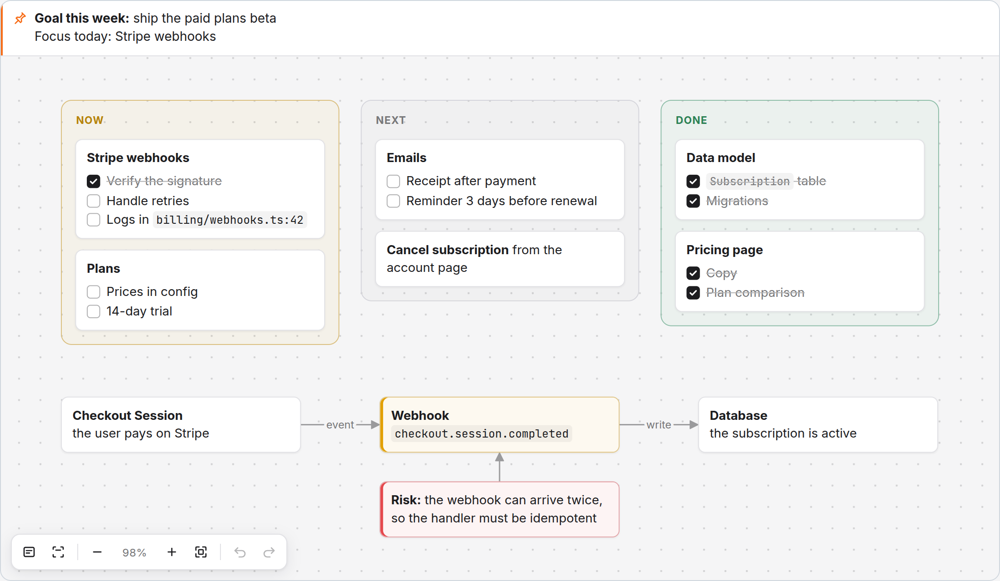

# Desk — a whiteboard next to your AI agent

English · [Русский](README.ru.md)

Keep the goal, the focus and the tasks in front of you. Ask Claude Code to put a plan, a task list or a diagram on the board, and it shows up in a VS Code tab beside the chat. You move cards, fix text and tick tasks with the mouse, and the agent sees your edits.



## How it works

```
Claude Code ──MCP──> desk server ──writes──> .desk/board.canvas <──watches── VS Code tab
                                                                <──your edits─────┘
```

The board is a file in your project, `.desk/board.canvas`, in the open [JSON Canvas](https://jsoncanvas.org) format. Obsidian opens it too, and in git each card is one line of the diff.

## Install

1. Download [`desk.vsix`](https://github.com/MAGLeb/desk/releases/latest/download/desk.vsix) from the latest release and install it with `code --install-extension desk.vsix`, or in VS Code: Extensions → `⋯` → **Install from VSIX…**
2. Run **Desk: Connect Claude Code (MCP)** from the Command Palette and pick **Run in terminal**. This registers the board server for all your projects.
3. Start a new Claude Code session.

You need VS Code 1.90 or later, Node.js 18 or later, and the Claude Code CLI.

## Use

- Tell the agent: "put the goal and the tasks on the board", "draw the module diagram on the board", "mark what's done on the board". If the board is closed, it opens next to the chat by itself.
- To open it yourself, click **Board** in the status bar or run **Desk: Open Board**.
- The goal and focus stay pinned at the top at any zoom.

| Action | How |
|---|---|
| New card | double-click the board |
| Edit text | double-click a card; Esc or a click outside saves |
| Tick a task | click the checkbox of a `- [ ]` item |
| Move | drag; dropped into a column, a card slots in between the others |
| Arrow | drag from the dot on a card's edge; drop on empty space to get a new card |
| Color, pin, delete | select, then use the bar at the top |
| Resize | drag the corner of a selected card |
| Pan | drag empty space, scroll, or hold Space and drag |
| Zoom | Ctrl + scroll, `+` / `-`; Shift+1 fits everything |
| Undo | Ctrl+Z / Ctrl+Shift+Z, including the agent's changes |
| Select several | Shift + click, or Shift + drag a frame |

File paths in cards (`src/app.ts:42`) and links are clickable and open in the editor.

## MCP tools

| Tool | What it does |
|---|---|
| `board_read` | the whole board: pinned focus, groups with their cards, arrows, ids and positions |
| `board_add` | cards, groups of cards and arrows, laid out automatically: column, row, grid or a flow along the arrows |
| `board_update` | text, color, size, position, moving a card into a group |
| `board_delete` | cards, groups or arrows, or the whole board |
| `board_focus` | the goal or focus pinned at the top |

The server looks for the board upward from its working directory: an existing `.desk/board.canvas` first, then the git root. `DESK_BOARD=/path/board.canvas` sets the file explicitly, and `node mcp-server.js --where` prints the path it will use.

Any MCP client can run the same server over stdio with `node mcp-server.js`. The extension keeps the file in its global storage, on Linux `~/.config/Code/User/globalStorage/celer.desk/mcp-server.js`. **Desk: Connect Claude Code (MCP)** → **Copy command** gives the exact path on your machine.

## Development

```
npm install
npm run build      # dist/: extension.js, mcp-server.js, webview.js
npm test           # end-to-end tests of the MCP server
npm run package    # desk.vsix
```

`test/harness.html` runs the board UI in a plain browser, without VS Code. Start `python3 -m http.server` in the repository root and open `/test/harness.html`, or `/test/harness.html?theme=dark`. The sample board `test/sample.canvas` is built through the MCP server itself: `node scripts/sample.mjs <dir>`.

To release, bump `version` in `package.json`, run `npm run package` and publish the file: `gh release create v<version> desk.vsix`.

## License

[MIT](LICENSE)
