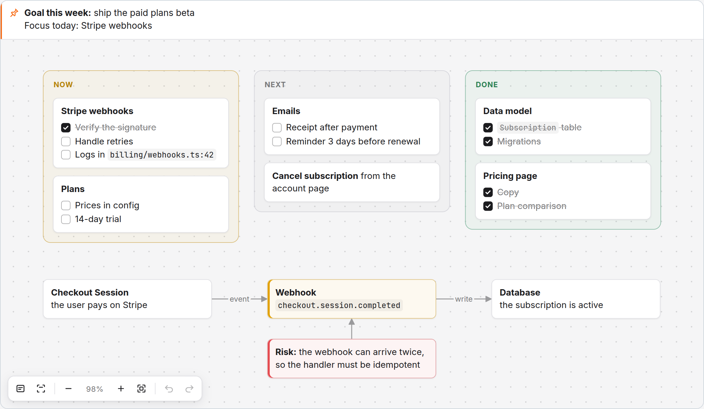

# Desk — доска рядом с AI-агентом

[English](README.md) · Русский

Цель, фокус и задачи всегда перед глазами. Попросите Claude Code вывести на доску план, список задач или схему, и они появятся во вкладке VS Code рядом с чатом. Вы двигаете карточки, правите текст и отмечаете задачи мышью, а агент видит ваши правки.



## Как это работает

```
Claude Code ──MCP──> сервер desk ──пишет──> .desk/board.canvas <──следит── вкладка VS Code
                                                               <──правки мышью────┘
```

Доска — файл проекта `.desk/board.canvas` в открытом формате [JSON Canvas](https://jsoncanvas.org). Его открывает и Obsidian, а в git каждая карточка занимает одну строку диффа.

## Установка

1. Скачайте [`desk.vsix`](https://github.com/MAGLeb/desk/releases/latest/download/desk.vsix) из последнего релиза и установите командой `code --install-extension desk.vsix` или в VS Code: Extensions → `⋯` → **Install from VSIX…**
2. В палитре команд запустите **Desk: Connect Claude Code (MCP)** и выберите **Run in terminal**. Команда подключит сервер доски ко всем вашим проектам.
3. Откройте новую сессию Claude Code.

Нужны VS Code 1.90 или новее, Node.js 18 или новее и Claude Code CLI.

## Как пользоваться

- Скажите агенту: «выведи на доску цель и задачи», «нарисуй на доске схему модулей», «отметь на доске, что сделано». Если доска закрыта, она сама откроется рядом с чатом.
- Открыть доску самому: кнопка **Board** в строке состояния или команда **Desk: Open Board**.
- Цель и фокус закреплены сверху и видны при любом масштабе.

| Действие | Как |
|---|---|
| Новая карточка | двойной клик по доске |
| Править текст | двойной клик по карточке; Esc или клик мимо сохраняет |
| Отметить задачу | клик по чекбоксу пункта `- [ ]` |
| Переместить | перетащить; в колонке карточка встаёт между другими |
| Стрелка | потянуть за точку на краю карточки; в пустоту — новая карточка |
| Цвет, закрепить, удалить | выделить, затем панель сверху |
| Размер | уголок выделенной карточки |
| Двигать доску | перетащить пустое место, колесо, пробел + мышь |
| Масштаб | Ctrl + колесо, `+` / `-`; Shift+1 — показать всё |
| Отмена | Ctrl+Z / Ctrl+Shift+Z, в том числе изменений агента |
| Выделить несколько | Shift + клик, Shift + рамка |

Пути в карточках (`src/app.ts:42`) и ссылки кликабельны и открываются в редакторе.

## Инструменты MCP

| Инструмент | Что делает |
|---|---|
| `board_read` | вся доска: закреп, группы с карточками, стрелки, id и координаты |
| `board_add` | карточки, группы с карточками и стрелки; раскладка автоматическая: колонка, ряд, сетка или поток по стрелкам |
| `board_update` | текст, цвет, размер, позиция, перенос карточки в группу |
| `board_delete` | карточки, группы или стрелки, или вся доска |
| `board_focus` | цель или фокус, закреплённые сверху |

Сервер ищет доску вверх от своей рабочей папки: сначала существующую `.desk/board.canvas`, затем корень git. Путь можно задать явно через `DESK_BOARD=/path/board.canvas`, а `node mcp-server.js --where` покажет, какой файл он возьмёт.

Тот же сервер работает с любым клиентом MCP по stdio: `node mcp-server.js`. Расширение хранит файл в своей глобальной папке, на Linux это `~/.config/Code/User/globalStorage/celer.desk/mcp-server.js`. Точный путь на вашей машине даёт **Desk: Connect Claude Code (MCP)** → **Copy command**.

## Разработка

```
npm install
npm run build      # dist/: extension.js, mcp-server.js, webview.js
npm test           # сквозные тесты MCP-сервера
npm run package    # desk.vsix
```

`test/harness.html` открывает интерфейс доски в обычном браузере без VS Code. Запустите `python3 -m http.server` в корне репозитория и откройте `/test/harness.html` или `/test/harness.html?theme=dark`. Пример доски `test/sample.canvas` собирается через сам MCP-сервер: `node scripts/sample.mjs <папка>`.

Новая версия: поднять `version` в `package.json`, выполнить `npm run package` и выложить файл в релиз: `gh release create v<версия> desk.vsix`.

## Лицензия

[MIT](LICENSE)
